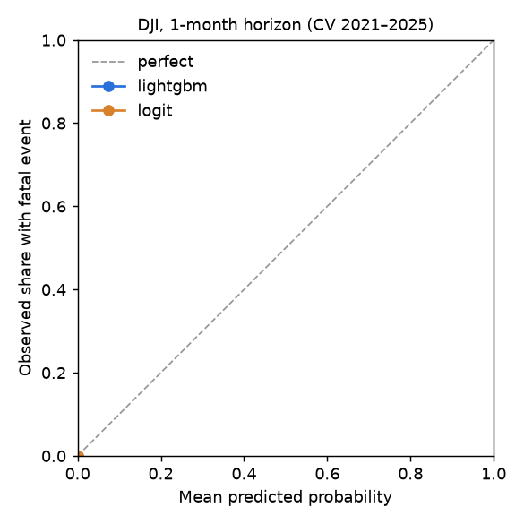
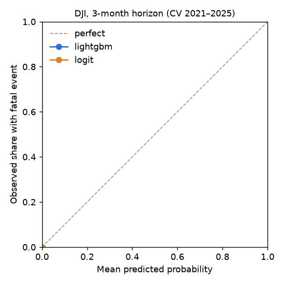

<!-- AUTO-GENERATED by `python -m aidtrace_pipeline.model --country DJI` on 2026-11-15. Narrative sections are in docs/MODEL_REPORT.md; this file holds the numbers. -->
# Model results: DJI (generated 2026-11-15)

Outcome: at least one fatal UCDP GED event in the unit in the target month. Expanding-window CV, test years 2021–2025 by target month. Precision/recall at an alert rate of 20% (persistence flags all units with a fatal event last month). 95% CIs: unit-cluster bootstrap, 200 reps.

## Pooled CV metrics (without ACLED)

`quiet-12m (onset)` = rows where the unit had no fatal event in the 12 months up to the origin. `Within-month AUC` = mean AUC computed separately for each target month (cross-sectional ranking).

| Horizon | Subset | Model | n | Base rate | AUC [95% CI] | Within-month AUC | Brier [95% CI] | Precision | Recall | Flag rate |
|---|---|---|---|---|---|---|---|---|---|---|
| 1 | all | lightgbm | 1200 | 0.001 | 0.100 [0.099, 0.100] | 0.500 | 0.001 [0.001, 0.003] | 0.000 | 0.000 | 0.214 |
| 1 | all | logit | 1200 | 0.001 | 0.100 [0.099, 0.100] | 0.500 | 0.001 [0.001, 0.003] | 0.000 | 0.000 | 0.230 |
| 1 | all | persistence | 1200 | 0.001 | 0.500 [0.499, 0.500] | 0.500 | 0.002 [0.002, 0.005] | 0.000 | 0.000 | 0.001 |
| 1 | quiet-12m | lightgbm | 1188 | 0.001 | 0.099 [0.097, 0.099] | 0.500 | 0.001 [0.001, 0.003] | 0.000 | 0.000 | 0.210 |
| 1 | quiet-12m | logit | 1188 | 0.001 | 0.099 [0.097, 0.099] | 0.500 | 0.001 [0.001, 0.003] | 0.000 | 0.000 | 0.226 |
| 1 | quiet-12m | persistence | 1188 | 0.001 | 0.500 [0.500, 0.500] | 0.500 | 0.001 [0.001, 0.003] | n/a | 0.000 | 0.000 |
| 3 | all | lightgbm | 1200 | 0.001 | 0.100 [0.099, 0.100] | 0.500 | 0.001 [0.001, 0.003] | 0.000 | 0.000 | 0.202 |
| 3 | all | logit | 1200 | 0.001 | 0.100 [0.099, 0.100] | 0.500 | 0.001 [0.001, 0.003] | 0.000 | 0.000 | 0.229 |
| 3 | all | persistence | 1200 | 0.001 | 0.500 [0.499, 0.500] | 0.500 | 0.002 [0.002, 0.005] | 0.000 | 0.000 | 0.001 |
| 3 | quiet-12m | lightgbm | 1188 | 0.001 | 0.100 [0.099, 0.100] | 0.500 | 0.001 [0.001, 0.003] | 0.000 | 0.000 | 0.208 |
| 3 | quiet-12m | logit | 1188 | 0.001 | 0.100 [0.099, 0.100] | 0.500 | 0.001 [0.001, 0.003] | 0.000 | 0.000 | 0.224 |
| 3 | quiet-12m | persistence | 1188 | 0.001 | 0.500 [0.500, 0.500] | 0.500 | 0.001 [0.001, 0.003] | n/a | 0.000 | 0.000 |

## Per test year (AUC / Brier)

| Horizon | Year | lightgbm AUC | logit AUC | persistence AUC | lightgbm Brier | logit Brier | persistence Brier |
|---|---|---|---|---|---|---|---|
| 1 | 2021 | 0.500 | 0.500 | 0.498 | 0.004 | 0.004 | 0.008 |
| 1 | 2022 | n/a | n/a | n/a | 0.000 | 0.000 | 0.000 |
| 1 | 2023 | n/a | n/a | n/a | 0.000 | 0.000 | 0.000 |
| 1 | 2024 | n/a | n/a | n/a | 0.000 | 0.000 | 0.000 |
| 1 | 2025 | n/a | n/a | n/a | 0.000 | 0.000 | 0.000 |
| 3 | 2021 | 0.500 | 0.500 | 0.498 | 0.004 | 0.004 | 0.008 |
| 3 | 2022 | n/a | n/a | n/a | 0.000 | 0.000 | 0.000 |
| 3 | 2023 | n/a | n/a | n/a | 0.000 | 0.000 | 0.000 |
| 3 | 2024 | n/a | n/a | n/a | 0.000 | 0.000 | 0.000 |
| 3 | 2025 | n/a | n/a | n/a | 0.000 | 0.000 | 0.000 |

## Calibration

LightGBM h=1 reliability: 0.00→0.00 (n=1200)

LightGBM h=3 reliability: 0.00→0.00 (n=1200)

## Top LightGBM features (gain, model trained on all known rows)

- h=1: log_area (51%), target_moy_sin (22%), nmc_cinc (15%), target_moy_cos (8%), months_since_fatal (5%), nmc_log_milper (0%), fatal_lag3 (0%), events_lag3 (0%), fatal_lag1 (0%), events_lag1 (0%)
- h=3: months_since_fatal (47%), target_moy_sin (20%), nmc_cinc (14%), target_moy_cos (12%), log_area (6%), fatal_lag6 (0%), fatal_lag3 (0%), events_lag3 (0%), fatal_lag1 (0%), events_lag1 (0%)

## With vs without ACLED (rolling monthly origin within ACLED coverage)

| Horizon | Variant | Model | n | AUC [95% CI] | Brier |
|---|---|---|---|---|---|
| 1 | h1 without ACLED | lightgbm | 200 | n/a [n/a, n/a] | 0.000 |
| 1 | h1 without ACLED | logit | 200 | n/a [n/a, n/a] | 0.000 |
| 1 | h1 with ACLED | lightgbm | 200 | n/a [n/a, n/a] | 0.000 |
| 1 | **ΔAUC (with − without, LightGBM)** | | 200 | n/a [n/a, n/a] | |
| 3 | h3 without ACLED | lightgbm | 200 | n/a [n/a, n/a] | 0.000 |
| 3 | h3 without ACLED | logit | 200 | n/a [n/a, n/a] | 0.000 |
| 3 | h3 with ACLED | lightgbm | 200 | n/a [n/a, n/a] | 0.000 |
| 3 | **ΔAUC (with − without, LightGBM)** | | 200 | n/a [n/a, n/a] | |

## Latest scores

Model: `lightgbm_bagged_pooled_no_acled`. Forecast origin 2025-12 (last month with UCDP data; 11 months before today).

| Horizon | Target | low | elevated | high | severe | Mean prob |
|---|---|---|---|---|---|---|
| 1 | 2026-01 | 20 | 0 | 0 | 0 | 0.002 |
| 3 | 2026-03 | 20 | 0 | 0 | 0 | 0.002 |

## VIEWS benchmark

Not computed: the only VIEWS run supplied (fatalities003, 2026-09) forecasts 2026-10 onwards, and no UCDP outcomes exist for those months. A benchmark needs archived VIEWS runs covering 2021–2025.
