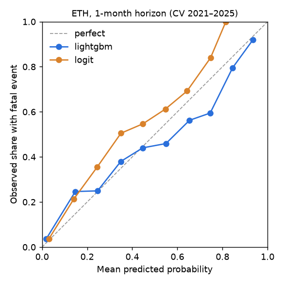
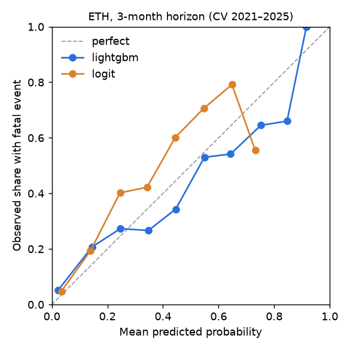

<!-- AUTO-GENERATED by `python -m aidtrace_pipeline.model --country ETH` on 2026-11-15. Narrative sections are in docs/MODEL_REPORT.md; this file holds the numbers. -->
# Model results: ETH (generated 2026-11-15)

Outcome: at least one fatal UCDP GED event in the unit in the target month. Expanding-window CV, test years 2021–2025 by target month. Precision/recall at an alert rate of 20% (persistence flags all units with a fatal event last month). 95% CIs: unit-cluster bootstrap, 200 reps.

## Pooled CV metrics (without ACLED)

`quiet-12m (onset)` = rows where the unit had no fatal event in the 12 months up to the origin. `Within-month AUC` = mean AUC computed separately for each target month (cross-sectional ranking).

| Horizon | Subset | Model | n | Base rate | AUC [95% CI] | Within-month AUC | Brier [95% CI] | Precision | Recall | Flag rate |
|---|---|---|---|---|---|---|---|---|---|---|
| 1 | all | lightgbm | 6420 | 0.119 | 0.862 [0.836, 0.884] | 0.858 | 0.080 [0.064, 0.100] | 0.403 | 0.676 | 0.200 |
| 1 | all | logit | 6420 | 0.119 | 0.880 [0.859, 0.900] | 0.873 | 0.075 [0.059, 0.094] | 0.434 | 0.727 | 0.200 |
| 1 | all | persistence | 6420 | 0.119 | 0.725 [0.704, 0.752] | 0.713 | 0.114 [0.091, 0.142] | 0.521 | 0.513 | 0.118 |
| 1 | quiet-12m | lightgbm | 4028 | 0.019 | 0.655 [0.576, 0.731] | 0.690 | 0.018 [0.014, 0.023] | 0.040 | 0.427 | 0.200 |
| 1 | quiet-12m | logit | 4028 | 0.019 | 0.607 [0.510, 0.687] | 0.701 | 0.018 [0.014, 0.024] | 0.036 | 0.387 | 0.200 |
| 1 | quiet-12m | persistence | 4028 | 0.019 | 0.500 [0.500, 0.500] | 0.500 | 0.019 [0.014, 0.024] | n/a | 0.000 | 0.000 |
| 3 | all | lightgbm | 6420 | 0.119 | 0.819 [0.778, 0.845] | 0.796 | 0.088 [0.070, 0.110] | 0.338 | 0.567 | 0.200 |
| 3 | all | logit | 6420 | 0.119 | 0.835 [0.800, 0.860] | 0.828 | 0.083 [0.066, 0.103] | 0.387 | 0.649 | 0.200 |
| 3 | all | persistence | 6420 | 0.119 | 0.682 [0.655, 0.711] | 0.673 | 0.130 [0.106, 0.160] | 0.453 | 0.436 | 0.115 |
| 3 | quiet-12m | lightgbm | 4051 | 0.027 | 0.710 [0.648, 0.759] | 0.732 | 0.026 [0.020, 0.034] | 0.062 | 0.450 | 0.200 |
| 3 | quiet-12m | logit | 4051 | 0.027 | 0.563 [0.481, 0.640] | 0.696 | 0.027 [0.020, 0.035] | 0.049 | 0.360 | 0.201 |
| 3 | quiet-12m | persistence | 4051 | 0.027 | 0.500 [0.500, 0.500] | 0.500 | 0.027 [0.020, 0.036] | n/a | 0.000 | 0.000 |

## Per test year (AUC / Brier)

| Horizon | Year | lightgbm AUC | logit AUC | persistence AUC | lightgbm Brier | logit Brier | persistence Brier |
|---|---|---|---|---|---|---|---|
| 1 | 2021 | 0.806 | 0.839 | 0.724 | 0.071 | 0.070 | 0.090 |
| 1 | 2022 | 0.842 | 0.864 | 0.666 | 0.086 | 0.081 | 0.132 |
| 1 | 2023 | 0.804 | 0.824 | 0.677 | 0.083 | 0.073 | 0.111 |
| 1 | 2024 | 0.903 | 0.914 | 0.742 | 0.084 | 0.075 | 0.111 |
| 1 | 2025 | 0.919 | 0.925 | 0.774 | 0.076 | 0.076 | 0.127 |
| 3 | 2021 | 0.621 | 0.698 | 0.624 | 0.091 | 0.084 | 0.118 |
| 3 | 2022 | 0.796 | 0.839 | 0.606 | 0.092 | 0.087 | 0.154 |
| 3 | 2023 | 0.755 | 0.764 | 0.631 | 0.086 | 0.081 | 0.130 |
| 3 | 2024 | 0.881 | 0.904 | 0.705 | 0.090 | 0.083 | 0.122 |
| 3 | 2025 | 0.913 | 0.918 | 0.777 | 0.081 | 0.082 | 0.125 |

## Calibration

LightGBM h=1 reliability: 0.02→0.04 (n=4794); 0.15→0.25 (n=495); 0.25→0.25 (n=369); 0.35→0.38 (n=229); 0.45→0.44 (n=159); 0.55→0.46 (n=135); 0.65→0.56 (n=96); 0.75→0.59 (n=74); 0.84→0.80 (n=44); 0.94→0.92 (n=25)

LightGBM h=3 reliability: 0.02→0.05 (n=4718); 0.14→0.21 (n=662); 0.25→0.27 (n=399); 0.35→0.27 (n=214); 0.45→0.34 (n=134); 0.55→0.53 (n=100); 0.64→0.54 (n=72); 0.75→0.65 (n=62); 0.85→0.66 (n=50); 0.92→1.00 (n=9)

## Top LightGBM features (gain, model trained on all known rows)

- h=1: events_statebased_sum12 (33%), months_since_fatal (19%), log_area (4%), ldeaths_sum3_splag (4%), fatal_mean36 (4%), imprecise_country_sum3 (4%), fatal_mean12 (3%), fatal_mean12_splag (3%), fatal_lag1_splag (3%), ldeaths_sum12 (3%)
- h=3: events_statebased_sum12 (35%), months_since_fatal (10%), log_area (6%), fatal_mean36 (5%), fatal_mean12_splag (5%), ldeaths_sum6 (4%), ldeaths_sum3_splag (4%), imprecise_country_sum3 (4%), nmc_log_milex (3%), ldeaths_sum12 (3%)

## With vs without ACLED (rolling monthly origin within ACLED coverage)

| Horizon | Variant | Model | n | AUC [95% CI] | Brier |
|---|---|---|---|---|---|
| 1 | h1 without ACLED | lightgbm | 1070 | 0.924 [0.890, 0.950] | 0.074 |
| 1 | h1 without ACLED | logit | 1070 | 0.927 [0.890, 0.949] | 0.074 |
| 1 | h1 with ACLED | lightgbm | 1070 | 0.925 [0.892, 0.949] | 0.074 |
| 1 | **ΔAUC (with − without, LightGBM)** | | 1070 | 0.001 [-0.002, 0.004] | |
| 3 | h3 without ACLED | lightgbm | 1070 | 0.922 [0.886, 0.948] | 0.075 |
| 3 | h3 without ACLED | logit | 1070 | 0.920 [0.885, 0.943] | 0.077 |
| 3 | h3 with ACLED | lightgbm | 1070 | 0.918 [0.882, 0.945] | 0.078 |
| 3 | **ΔAUC (with − without, LightGBM)** | | 1070 | -0.004 [-0.006, -0.001] | |

### Secondary model: any ACLED event, h=1

Test months: 2025-05, 2025-06, 2025-07, 2025-08, 2025-09, 2025-10

| Model | n | Base rate | AUC [95% CI] | Brier |
|---|---|---|---|---|
| logit | 642 | 0.232 | 0.776 [0.698, 0.828] | 0.137 |
| persistence | 642 | 0.232 | 0.695 [0.620, 0.745] | 0.217 |

## Latest scores

Model: `lightgbm_bagged_pooled_no_acled`. Forecast origin 2025-12 (last month with UCDP data; 11 months before today).

| Horizon | Target | low | elevated | high | severe | Mean prob |
|---|---|---|---|---|---|---|
| 1 | 2026-01 | 74 | 9 | 16 | 8 | 0.154 |
| 3 | 2026-03 | 73 | 11 | 16 | 7 | 0.148 |

## VIEWS benchmark

Not computed: the only VIEWS run supplied (fatalities003, 2026-09) forecasts 2026-10 onwards, and no UCDP outcomes exist for those months. A benchmark needs archived VIEWS runs covering 2021–2025.
