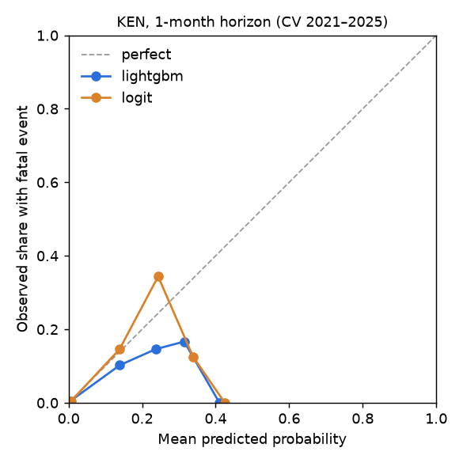
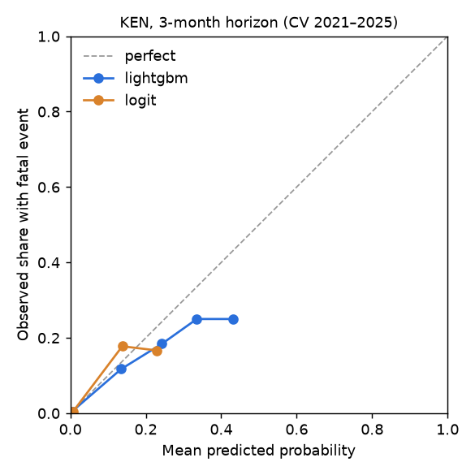

<!-- AUTO-GENERATED by `python -m aidtrace_pipeline.model --country KEN` on 2026-11-15. Narrative sections are in docs/MODEL_REPORT.md; this file holds the numbers. -->
# Model results: KEN (generated 2026-11-15)

Outcome: at least one fatal UCDP GED event in the unit in the target month. Expanding-window CV, test years 2021–2025 by target month. Precision/recall at an alert rate of 20% (persistence flags all units with a fatal event last month). 95% CIs: unit-cluster bootstrap, 200 reps.

## Pooled CV metrics (without ACLED)

`quiet-12m (onset)` = rows where the unit had no fatal event in the 12 months up to the origin. `Within-month AUC` = mean AUC computed separately for each target month (cross-sectional ranking).

| Horizon | Subset | Model | n | Base rate | AUC [95% CI] | Within-month AUC | Brier [95% CI] | Precision | Recall | Flag rate |
|---|---|---|---|---|---|---|---|---|---|---|
| 1 | all | lightgbm | 17400 | 0.006 | 0.944 [0.913, 0.965] | 0.929 | 0.006 [0.003, 0.008] | 0.030 | 0.954 | 0.200 |
| 1 | all | logit | 17400 | 0.006 | 0.951 [0.919, 0.969] | 0.944 | 0.006 [0.003, 0.008] | 0.030 | 0.963 | 0.200 |
| 1 | all | persistence | 17400 | 0.006 | 0.585 [0.540, 0.622] | 0.582 | 0.010 [0.006, 0.014] | 0.171 | 0.176 | 0.006 |
| 1 | quiet-12m | lightgbm | 16627 | 0.002 | 0.892 [0.791, 0.949] | 0.806 | 0.002 [0.001, 0.003] | 0.008 | 0.871 | 0.200 |
| 1 | quiet-12m | logit | 16627 | 0.002 | 0.899 [0.823, 0.949] | 0.854 | 0.002 [0.001, 0.003] | 0.005 | 0.935 | 0.344 |
| 1 | quiet-12m | persistence | 16627 | 0.002 | 0.500 [0.500, 0.500] | 0.500 | 0.002 [0.001, 0.003] | n/a | 0.000 | 0.000 |
| 3 | all | lightgbm | 17400 | 0.006 | 0.942 [0.913, 0.962] | 0.930 | 0.006 [0.003, 0.008] | 0.030 | 0.954 | 0.200 |
| 3 | all | logit | 17400 | 0.006 | 0.946 [0.912, 0.966] | 0.941 | 0.006 [0.003, 0.008] | 0.030 | 0.963 | 0.200 |
| 3 | all | persistence | 17400 | 0.006 | 0.567 [0.516, 0.605] | 0.599 | 0.011 [0.006, 0.015] | 0.134 | 0.139 | 0.006 |
| 3 | quiet-12m | lightgbm | 16603 | 0.002 | 0.896 [0.813, 0.951] | 0.848 | 0.002 [0.001, 0.003] | 0.009 | 0.853 | 0.200 |
| 3 | quiet-12m | logit | 16603 | 0.002 | 0.901 [0.830, 0.943] | 0.868 | 0.002 [0.001, 0.003] | 0.006 | 0.941 | 0.343 |
| 3 | quiet-12m | persistence | 16603 | 0.002 | 0.500 [0.500, 0.500] | 0.500 | 0.002 [0.001, 0.003] | n/a | 0.000 | 0.000 |

## Per test year (AUC / Brier)

| Horizon | Year | lightgbm AUC | logit AUC | persistence AUC | lightgbm Brier | logit Brier | persistence Brier |
|---|---|---|---|---|---|---|---|
| 1 | 2021 | 0.907 | 0.905 | 0.530 | 0.008 | 0.008 | 0.015 |
| 1 | 2022 | 0.919 | 0.908 | 0.533 | 0.004 | 0.004 | 0.009 |
| 1 | 2023 | 0.974 | 0.985 | 0.709 | 0.007 | 0.006 | 0.009 |
| 1 | 2024 | 0.958 | 0.970 | 0.562 | 0.006 | 0.006 | 0.011 |
| 1 | 2025 | 0.945 | 0.942 | 0.565 | 0.004 | 0.004 | 0.008 |
| 3 | 2021 | 0.901 | 0.897 | 0.563 | 0.008 | 0.008 | 0.015 |
| 3 | 2022 | 0.925 | 0.913 | 0.497 | 0.004 | 0.004 | 0.009 |
| 3 | 2023 | 0.971 | 0.976 | 0.555 | 0.007 | 0.007 | 0.013 |
| 3 | 2024 | 0.962 | 0.964 | 0.606 | 0.006 | 0.006 | 0.010 |
| 3 | 2025 | 0.944 | 0.944 | 0.598 | 0.004 | 0.004 | 0.007 |

## Calibration

LightGBM h=1 reliability: 0.00→0.00 (n=17102); 0.14→0.10 (n=234); 0.24→0.15 (n=48); 0.31→0.17 (n=12); 0.41→0.00 (n=4)

LightGBM h=3 reliability: 0.00→0.00 (n=17188); 0.13→0.12 (n=162); 0.24→0.18 (n=38); 0.34→0.25 (n=8); 0.43→0.25 (n=4)

## Top LightGBM features (gain, model trained on all known rows)

- h=1: months_since_fatal (28%), fatal_mean36 (20%), log_pop_density (5%), fatal_mean12_splag (4%), u5_share (4%), nmc_cinc (4%), log_area (4%), target_moy_sin (4%), log_pop (4%), ldeaths_sum3_splag (3%)
- h=3: months_since_fatal (27%), fatal_mean36 (20%), log_area (6%), log_pop_density (5%), nmc_cinc (5%), u5_share (5%), fatal_mean12_splag (4%), log_pop (4%), target_moy_sin (4%), nmc_log_milex (3%)

## With vs without ACLED (rolling monthly origin within ACLED coverage)

| Horizon | Variant | Model | n | AUC [95% CI] | Brier |
|---|---|---|---|---|---|
| 1 | h1 without ACLED | lightgbm | 2900 | 0.916 [0.728, 0.993] | 0.004 |
| 1 | h1 without ACLED | logit | 2900 | 0.913 [0.719, 0.991] | 0.004 |
| 1 | h1 with ACLED | lightgbm | 2900 | 0.910 [0.709, 0.992] | 0.004 |
| 1 | **ΔAUC (with − without, LightGBM)** | | 2900 | -0.006 [-0.019, 0.001] | |
| 3 | h3 without ACLED | lightgbm | 2900 | 0.907 [0.695, 0.994] | 0.004 |
| 3 | h3 without ACLED | logit | 2900 | 0.920 [0.743, 0.993] | 0.004 |
| 3 | h3 with ACLED | lightgbm | 2900 | 0.910 [0.699, 0.996] | 0.004 |
| 3 | **ΔAUC (with − without, LightGBM)** | | 2900 | 0.003 [-0.000, 0.008] | |

### Secondary model: any ACLED event, h=1

Test months: 2025-05, 2025-06, 2025-07, 2025-08, 2025-09, 2025-10

| Model | n | Base rate | AUC [95% CI] | Brier |
|---|---|---|---|---|
| logit | 1740 | 0.242 | 0.583 [0.546, 0.618] | 0.179 |
| persistence | 1740 | 0.242 | 0.555 [0.526, 0.579] | 0.327 |

## Latest scores

Model: `lightgbm_bagged_pooled_no_acled`. Forecast origin 2025-12 (last month with UCDP data; 11 months before today).

| Horizon | Target | low | elevated | high | severe | Mean prob |
|---|---|---|---|---|---|---|
| 1 | 2026-01 | 287 | 3 | 0 | 0 | 0.006 |
| 3 | 2026-03 | 287 | 3 | 0 | 0 | 0.006 |

## VIEWS benchmark

Not computed: the only VIEWS run supplied (fatalities003, 2026-09) forecasts 2026-10 onwards, and no UCDP outcomes exist for those months. A benchmark needs archived VIEWS runs covering 2021–2025.
