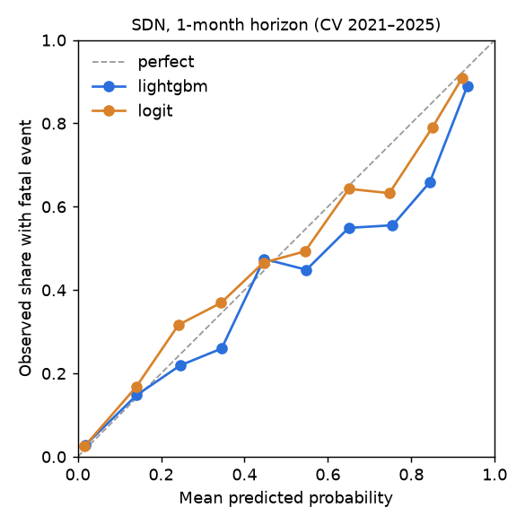
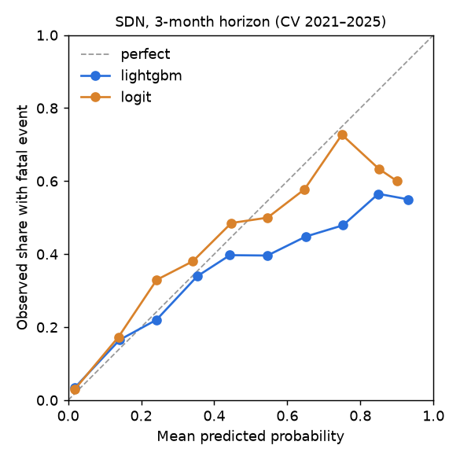

<!-- AUTO-GENERATED by `python -m aidtrace_pipeline.model --country SDN` on 2026-11-15. Narrative sections are in docs/MODEL_REPORT.md; this file holds the numbers. -->
# Model results: SDN (generated 2026-11-15)

Outcome: at least one fatal UCDP GED event in the unit in the target month. Expanding-window CV, test years 2021–2025 by target month. Precision/recall at an alert rate of 20% (persistence flags all units with a fatal event last month). 95% CIs: unit-cluster bootstrap, 200 reps.

## Pooled CV metrics (without ACLED)

`quiet-12m (onset)` = rows where the unit had no fatal event in the 12 months up to the origin. `Within-month AUC` = mean AUC computed separately for each target month (cross-sectional ranking).

| Horizon | Subset | Model | n | Base rate | AUC [95% CI] | Within-month AUC | Brier [95% CI] | Precision | Recall | Flag rate |
|---|---|---|---|---|---|---|---|---|---|---|
| 1 | all | lightgbm | 11340 | 0.058 | 0.852 [0.822, 0.879] | 0.834 | 0.045 [0.036, 0.055] | 0.209 | 0.718 | 0.200 |
| 1 | all | logit | 11340 | 0.058 | 0.857 [0.826, 0.883] | 0.845 | 0.042 [0.034, 0.052] | 0.211 | 0.725 | 0.200 |
| 1 | all | persistence | 11340 | 0.058 | 0.696 [0.649, 0.734] | 0.660 | 0.066 [0.054, 0.080] | 0.433 | 0.426 | 0.057 |
| 1 | quiet-12m | lightgbm | 8637 | 0.018 | 0.698 [0.660, 0.740] | 0.674 | 0.017 [0.015, 0.020] | 0.038 | 0.434 | 0.200 |
| 1 | quiet-12m | logit | 8637 | 0.018 | 0.658 [0.615, 0.699] | 0.659 | 0.017 [0.014, 0.020] | 0.035 | 0.401 | 0.201 |
| 1 | quiet-12m | persistence | 8637 | 0.018 | 0.500 [0.500, 0.500] | 0.500 | 0.018 [0.015, 0.021] | n/a | 0.000 | 0.000 |
| 3 | all | lightgbm | 11340 | 0.058 | 0.805 [0.768, 0.841] | 0.799 | 0.049 [0.039, 0.061] | 0.183 | 0.625 | 0.200 |
| 3 | all | logit | 11340 | 0.058 | 0.827 [0.793, 0.857] | 0.821 | 0.046 [0.037, 0.056] | 0.197 | 0.675 | 0.200 |
| 3 | all | persistence | 11340 | 0.058 | 0.657 [0.611, 0.700] | 0.647 | 0.071 [0.057, 0.086] | 0.382 | 0.349 | 0.053 |
| 3 | quiet-12m | lightgbm | 8744 | 0.022 | 0.647 [0.606, 0.687] | 0.628 | 0.021 [0.018, 0.025] | 0.039 | 0.362 | 0.200 |
| 3 | quiet-12m | logit | 8744 | 0.022 | 0.647 [0.600, 0.691] | 0.648 | 0.021 [0.017, 0.024] | 0.042 | 0.388 | 0.200 |
| 3 | quiet-12m | persistence | 8744 | 0.022 | 0.500 [0.500, 0.500] | 0.500 | 0.022 [0.017, 0.025] | n/a | 0.000 | 0.000 |

## Per test year (AUC / Brier)

| Horizon | Year | lightgbm AUC | logit AUC | persistence AUC | lightgbm Brier | logit Brier | persistence Brier |
|---|---|---|---|---|---|---|---|
| 1 | 2021 | 0.805 | 0.806 | 0.600 | 0.018 | 0.017 | 0.028 |
| 1 | 2022 | 0.839 | 0.887 | 0.625 | 0.025 | 0.024 | 0.044 |
| 1 | 2023 | 0.850 | 0.849 | 0.732 | 0.041 | 0.037 | 0.049 |
| 1 | 2024 | 0.834 | 0.838 | 0.710 | 0.068 | 0.068 | 0.104 |
| 1 | 2025 | 0.819 | 0.821 | 0.684 | 0.071 | 0.065 | 0.104 |
| 3 | 2021 | 0.730 | 0.784 | 0.553 | 0.018 | 0.018 | 0.029 |
| 3 | 2022 | 0.816 | 0.881 | 0.663 | 0.026 | 0.024 | 0.041 |
| 3 | 2023 | 0.786 | 0.807 | 0.652 | 0.044 | 0.042 | 0.059 |
| 3 | 2024 | 0.772 | 0.791 | 0.663 | 0.081 | 0.072 | 0.113 |
| 3 | 2025 | 0.812 | 0.801 | 0.655 | 0.077 | 0.071 | 0.112 |

## Calibration

LightGBM h=1 reliability: 0.02→0.03 (n=9871); 0.14→0.15 (n=668); 0.25→0.22 (n=283); 0.35→0.26 (n=154); 0.45→0.47 (n=99); 0.55→0.45 (n=78); 0.65→0.55 (n=71); 0.76→0.56 (n=54); 0.84→0.66 (n=44); 0.93→0.89 (n=18)

LightGBM h=3 reliability: 0.02→0.03 (n=10107); 0.14→0.17 (n=599); 0.24→0.22 (n=227); 0.35→0.34 (n=109); 0.44→0.40 (n=73); 0.55→0.40 (n=53); 0.65→0.45 (n=58); 0.75→0.48 (n=48); 0.85→0.57 (n=46); 0.93→0.55 (n=20)

## Top LightGBM features (gain, model trained on all known rows)

- h=1: months_since_fatal (15%), fatal_mean6 (13%), fatal_mean3 (12%), ldeaths_sum3 (8%), ldeaths_sum3_splag (6%), ldeaths_sum12 (5%), log_area (5%), fatal_mean36 (4%), ldeaths_sum6 (4%), fatal_mean12_splag (3%)
- h=3: months_since_fatal (28%), log_area (8%), fatal_mean36 (7%), ldeaths_sum3 (7%), nmc_cinc (6%), fatal_mean12_splag (5%), ldeaths_sum3_splag (5%), ldeaths_sum12 (4%), imprecise_country_sum3 (4%), ldeaths_sum6 (4%)

## With vs without ACLED (rolling monthly origin within ACLED coverage)

| Horizon | Variant | Model | n | AUC [95% CI] | Brier |
|---|---|---|---|---|---|
| 1 | h1 without ACLED | lightgbm | 1890 | 0.820 [0.771, 0.866] | 0.065 |
| 1 | h1 without ACLED | logit | 1890 | 0.816 [0.772, 0.856] | 0.064 |
| 1 | h1 with ACLED | lightgbm | 1890 | 0.818 [0.769, 0.861] | 0.065 |
| 1 | **ΔAUC (with − without, LightGBM)** | | 1890 | -0.002 [-0.009, 0.006] | |
| 3 | h3 without ACLED | lightgbm | 1890 | 0.816 [0.774, 0.861] | 0.068 |
| 3 | h3 without ACLED | logit | 1890 | 0.786 [0.729, 0.832] | 0.072 |
| 3 | h3 with ACLED | lightgbm | 1890 | 0.811 [0.765, 0.854] | 0.068 |
| 3 | **ΔAUC (with − without, LightGBM)** | | 1890 | -0.005 [-0.015, 0.003] | |

### Secondary model: any ACLED event, h=1

Test months: 2025-05, 2025-06, 2025-07, 2025-08, 2025-09, 2025-10

| Model | n | Base rate | AUC [95% CI] | Brier |
|---|---|---|---|---|
| logit | 1134 | 0.219 | 0.747 [0.696, 0.793] | 0.141 |
| persistence | 1134 | 0.219 | 0.680 [0.634, 0.723] | 0.224 |

## Latest scores

Model: `lightgbm_bagged_pooled_no_acled`. Forecast origin 2025-12 (last month with UCDP data; 11 months before today).

| Horizon | Target | low | elevated | high | severe | Mean prob |
|---|---|---|---|---|---|---|
| 1 | 2026-01 | 137 | 35 | 14 | 3 | 0.096 |
| 3 | 2026-03 | 137 | 37 | 15 | 0 | 0.091 |

## VIEWS benchmark

Not computed: the only VIEWS run supplied (fatalities003, 2026-09) forecasts 2026-10 onwards, and no UCDP outcomes exist for those months. A benchmark needs archived VIEWS runs covering 2021–2025.
