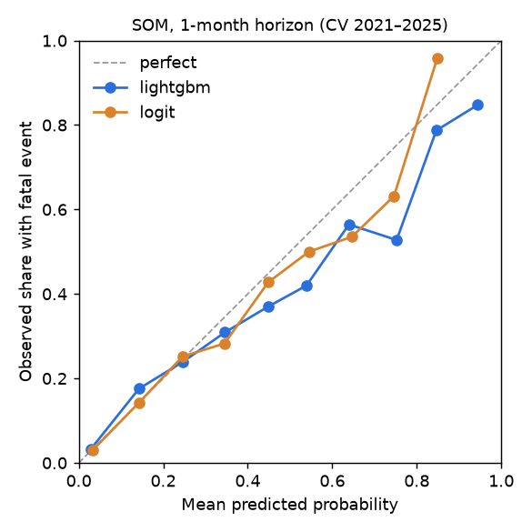
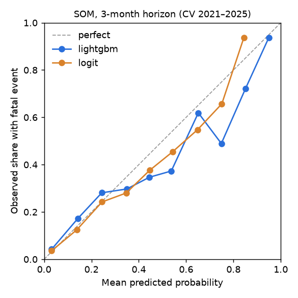

<!-- AUTO-GENERATED by `python -m aidtrace_pipeline.model --country SOM` on 2026-11-15. Narrative sections are in docs/MODEL_REPORT.md; this file holds the numbers. -->
# Model results: SOM (generated 2026-11-15)

Outcome: at least one fatal UCDP GED event in the unit in the target month. Expanding-window CV, test years 2021–2025 by target month. Precision/recall at an alert rate of 20% (persistence flags all units with a fatal event last month). 95% CIs: unit-cluster bootstrap, 200 reps.

## Pooled CV metrics (without ACLED)

`quiet-12m (onset)` = rows where the unit had no fatal event in the 12 months up to the origin. `Within-month AUC` = mean AUC computed separately for each target month (cross-sectional ranking).

| Horizon | Subset | Model | n | Base rate | AUC [95% CI] | Within-month AUC | Brier [95% CI] | Precision | Recall | Flag rate |
|---|---|---|---|---|---|---|---|---|---|---|
| 1 | all | lightgbm | 4440 | 0.132 | 0.846 [0.805, 0.883] | 0.850 | 0.089 [0.070, 0.109] | 0.391 | 0.592 | 0.200 |
| 1 | all | logit | 4440 | 0.132 | 0.844 [0.806, 0.881] | 0.849 | 0.088 [0.070, 0.107] | 0.404 | 0.613 | 0.200 |
| 1 | all | persistence | 4440 | 0.132 | 0.685 [0.637, 0.733] | 0.688 | 0.144 [0.112, 0.178] | 0.453 | 0.452 | 0.132 |
| 1 | quiet-12m | lightgbm | 2227 | 0.026 | 0.773 [0.690, 0.833] | 0.794 | 0.024 [0.016, 0.035] | 0.063 | 0.491 | 0.200 |
| 1 | quiet-12m | logit | 2227 | 0.026 | 0.775 [0.698, 0.833] | 0.810 | 0.024 [0.016, 0.035] | 0.067 | 0.526 | 0.202 |
| 1 | quiet-12m | persistence | 2227 | 0.026 | 0.500 [0.500, 0.500] | 0.500 | 0.026 [0.017, 0.036] | n/a | 0.000 | 0.000 |
| 3 | all | lightgbm | 4440 | 0.132 | 0.827 [0.781, 0.872] | 0.840 | 0.092 [0.073, 0.112] | 0.384 | 0.582 | 0.200 |
| 3 | all | logit | 4440 | 0.132 | 0.826 [0.777, 0.870] | 0.833 | 0.091 [0.072, 0.112] | 0.372 | 0.563 | 0.200 |
| 3 | all | persistence | 4440 | 0.132 | 0.631 [0.577, 0.693] | 0.640 | 0.168 [0.132, 0.208] | 0.363 | 0.358 | 0.130 |
| 3 | quiet-12m | lightgbm | 2213 | 0.033 | 0.767 [0.662, 0.831] | 0.782 | 0.032 [0.022, 0.043] | 0.079 | 0.473 | 0.200 |
| 3 | quiet-12m | logit | 2213 | 0.033 | 0.782 [0.704, 0.844] | 0.799 | 0.031 [0.022, 0.042] | 0.092 | 0.554 | 0.201 |
| 3 | quiet-12m | persistence | 2213 | 0.033 | 0.500 [0.500, 0.500] | 0.500 | 0.033 [0.023, 0.046] | n/a | 0.000 | 0.000 |

## Per test year (AUC / Brier)

| Horizon | Year | lightgbm AUC | logit AUC | persistence AUC | lightgbm Brier | logit Brier | persistence Brier |
|---|---|---|---|---|---|---|---|
| 1 | 2021 | 0.857 | 0.873 | 0.693 | 0.100 | 0.094 | 0.166 |
| 1 | 2022 | 0.842 | 0.837 | 0.691 | 0.091 | 0.083 | 0.135 |
| 1 | 2023 | 0.828 | 0.822 | 0.661 | 0.085 | 0.088 | 0.144 |
| 1 | 2024 | 0.833 | 0.828 | 0.670 | 0.079 | 0.080 | 0.132 |
| 1 | 2025 | 0.870 | 0.846 | 0.697 | 0.090 | 0.096 | 0.145 |
| 3 | 2021 | 0.839 | 0.864 | 0.668 | 0.101 | 0.097 | 0.180 |
| 3 | 2022 | 0.835 | 0.824 | 0.634 | 0.091 | 0.088 | 0.160 |
| 3 | 2023 | 0.820 | 0.804 | 0.628 | 0.088 | 0.090 | 0.167 |
| 3 | 2024 | 0.823 | 0.820 | 0.594 | 0.081 | 0.081 | 0.157 |
| 3 | 2025 | 0.835 | 0.810 | 0.618 | 0.100 | 0.101 | 0.176 |

## Calibration

LightGBM h=1 reliability: 0.03→0.03 (n=2755); 0.14→0.18 (n=666); 0.25→0.24 (n=355); 0.35→0.31 (n=246); 0.45→0.37 (n=146); 0.54→0.42 (n=81); 0.64→0.56 (n=62); 0.75→0.53 (n=36); 0.85→0.79 (n=47); 0.94→0.85 (n=46)

LightGBM h=3 reliability: 0.03→0.04 (n=2830); 0.14→0.17 (n=696); 0.24→0.28 (n=338); 0.35→0.30 (n=212); 0.44→0.35 (n=124); 0.54→0.37 (n=67); 0.65→0.62 (n=42); 0.75→0.49 (n=47); 0.85→0.72 (n=36); 0.95→0.94 (n=48)

## Top LightGBM features (gain, model trained on all known rows)

- h=1: fatal_mean36 (34%), events_statebased_sum12 (13%), months_since_fatal (7%), fatal_mean12_splag (5%), ldeaths_sum3_splag (5%), fatal_mean12 (4%), log_buildings (4%), ldeaths_sum6 (3%), ldeaths_sum12 (3%), log_area (3%)
- h=3: fatal_mean36 (34%), events_statebased_sum12 (10%), fatal_mean12 (7%), months_since_fatal (6%), log_buildings (5%), ldeaths_sum3_splag (4%), fatal_mean12_splag (4%), log_area (3%), ldeaths_sum6 (3%), ldeaths_sum12 (2%)

## With vs without ACLED (rolling monthly origin within ACLED coverage)

| Horizon | Variant | Model | n | AUC [95% CI] | Brier |
|---|---|---|---|---|---|
| 1 | h1 without ACLED | lightgbm | 740 | 0.878 [0.825, 0.921] | 0.090 |
| 1 | h1 without ACLED | logit | 740 | 0.864 [0.811, 0.907] | 0.097 |
| 1 | h1 with ACLED | lightgbm | 740 | 0.881 [0.829, 0.920] | 0.091 |
| 1 | **ΔAUC (with − without, LightGBM)** | | 740 | 0.003 [-0.004, 0.013] | |
| 3 | h3 without ACLED | lightgbm | 740 | 0.856 [0.801, 0.904] | 0.099 |
| 3 | h3 without ACLED | logit | 740 | 0.829 [0.754, 0.883] | 0.104 |
| 3 | h3 with ACLED | lightgbm | 740 | 0.852 [0.793, 0.904] | 0.099 |
| 3 | **ΔAUC (with − without, LightGBM)** | | 740 | -0.003 [-0.014, 0.008] | |

### Secondary model: any ACLED event, h=1

Test months: 2025-05, 2025-06, 2025-07, 2025-08, 2025-09, 2025-10

| Model | n | Base rate | AUC [95% CI] | Brier |
|---|---|---|---|---|
| logit | 444 | 0.493 | 0.777 [0.716, 0.828] | 0.192 |
| persistence | 444 | 0.493 | 0.696 [0.645, 0.742] | 0.304 |

## Latest scores

Model: `lightgbm_bagged_pooled_no_acled`. Forecast origin 2025-12 (last month with UCDP data; 11 months before today).

| Horizon | Target | low | elevated | high | severe | Mean prob |
|---|---|---|---|---|---|---|
| 1 | 2026-01 | 44 | 16 | 10 | 4 | 0.157 |
| 3 | 2026-03 | 44 | 17 | 10 | 3 | 0.160 |

## VIEWS benchmark

Not computed: the only VIEWS run supplied (fatalities003, 2026-09) forecasts 2026-10 onwards, and no UCDP outcomes exist for those months. A benchmark needs archived VIEWS runs covering 2021–2025.
