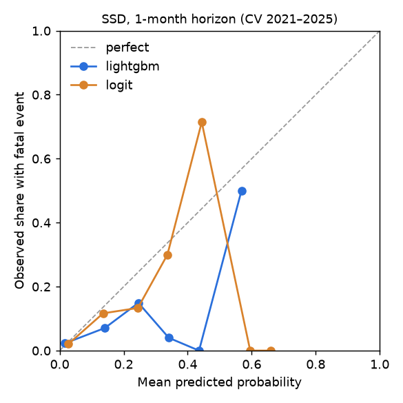
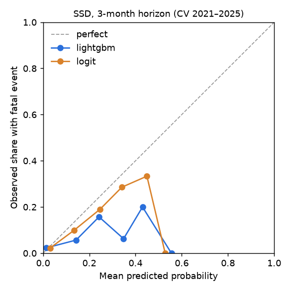

<!-- AUTO-GENERATED by `python -m aidtrace_pipeline.model --country SSD` on 2026-11-15. Narrative sections are in docs/MODEL_REPORT.md; this file holds the numbers. -->
# Model results: SSD (generated 2026-11-15)

Outcome: at least one fatal UCDP GED event in the unit in the target month. Expanding-window CV, test years 2021–2025 by target month. Precision/recall at an alert rate of 20% (persistence flags all units with a fatal event last month). 95% CIs: unit-cluster bootstrap, 200 reps.

## Pooled CV metrics (without ACLED)

`quiet-12m (onset)` = rows where the unit had no fatal event in the 12 months up to the origin. `Within-month AUC` = mean AUC computed separately for each target month (cross-sectional ranking).

| Horizon | Subset | Model | n | Base rate | AUC [95% CI] | Within-month AUC | Brier [95% CI] | Precision | Recall | Flag rate |
|---|---|---|---|---|---|---|---|---|---|---|
| 1 | all | lightgbm | 4740 | 0.027 | 0.673 [0.593, 0.751] | 0.682 | 0.027 [0.020, 0.036] | 0.057 | 0.429 | 0.200 |
| 1 | all | logit | 4740 | 0.027 | 0.702 [0.624, 0.770] | 0.737 | 0.025 [0.019, 0.033] | 0.070 | 0.524 | 0.200 |
| 1 | all | persistence | 4740 | 0.027 | 0.556 [0.503, 0.619] | 0.549 | 0.046 [0.035, 0.059] | 0.135 | 0.135 | 0.027 |
| 1 | quiet-12m | lightgbm | 3774 | 0.016 | 0.557 [0.486, 0.628] | 0.581 | 0.016 [0.013, 0.021] | 0.019 | 0.233 | 0.200 |
| 1 | quiet-12m | logit | 3774 | 0.016 | 0.554 [0.469, 0.615] | 0.630 | 0.016 [0.013, 0.020] | 0.017 | 0.217 | 0.203 |
| 1 | quiet-12m | persistence | 3774 | 0.016 | 0.500 [0.500, 0.500] | 0.500 | 0.016 [0.013, 0.021] | n/a | 0.000 | 0.000 |
| 3 | all | lightgbm | 4740 | 0.027 | 0.658 [0.578, 0.733] | 0.655 | 0.027 [0.020, 0.036] | 0.058 | 0.437 | 0.200 |
| 3 | all | logit | 4740 | 0.027 | 0.666 [0.577, 0.744] | 0.701 | 0.026 [0.019, 0.034] | 0.062 | 0.468 | 0.200 |
| 3 | all | persistence | 4740 | 0.027 | 0.548 [0.513, 0.583] | 0.548 | 0.045 [0.034, 0.061] | 0.127 | 0.119 | 0.025 |
| 3 | quiet-12m | lightgbm | 3783 | 0.018 | 0.527 [0.461, 0.594] | 0.530 | 0.018 [0.013, 0.023] | 0.018 | 0.209 | 0.200 |
| 3 | quiet-12m | logit | 3783 | 0.018 | 0.547 [0.464, 0.615] | 0.609 | 0.017 [0.013, 0.022] | 0.020 | 0.224 | 0.201 |
| 3 | quiet-12m | persistence | 3783 | 0.018 | 0.500 [0.500, 0.500] | 0.500 | 0.018 [0.013, 0.023] | n/a | 0.000 | 0.000 |

## Per test year (AUC / Brier)

| Horizon | Year | lightgbm AUC | logit AUC | persistence AUC | lightgbm Brier | logit Brier | persistence Brier |
|---|---|---|---|---|---|---|---|
| 1 | 2021 | 0.634 | 0.721 | 0.555 | 0.039 | 0.035 | 0.061 |
| 1 | 2022 | 0.686 | 0.733 | 0.580 | 0.038 | 0.034 | 0.063 |
| 1 | 2023 | 0.862 | 0.871 | 0.550 | 0.010 | 0.010 | 0.019 |
| 1 | 2024 | 0.679 | 0.629 | 0.572 | 0.013 | 0.013 | 0.022 |
| 1 | 2025 | 0.589 | 0.656 | 0.514 | 0.033 | 0.033 | 0.064 |
| 3 | 2021 | 0.621 | 0.660 | 0.585 | 0.038 | 0.036 | 0.055 |
| 3 | 2022 | 0.681 | 0.719 | 0.580 | 0.038 | 0.035 | 0.063 |
| 3 | 2023 | 0.841 | 0.870 | 0.549 | 0.010 | 0.010 | 0.022 |
| 3 | 2024 | 0.620 | 0.639 | 0.494 | 0.013 | 0.014 | 0.026 |
| 3 | 2025 | 0.541 | 0.612 | 0.487 | 0.033 | 0.033 | 0.059 |

## Calibration

LightGBM h=1 reliability: 0.02→0.02 (n=4454); 0.14→0.07 (n=184); 0.25→0.15 (n=67); 0.34→0.04 (n=25); 0.44→0.00 (n=8); 0.57→0.50 (n=2)

LightGBM h=3 reliability: 0.01→0.02 (n=4482); 0.14→0.06 (n=159); 0.24→0.16 (n=70); 0.35→0.06 (n=16); 0.43→0.20 (n=10); 0.56→0.00 (n=3)

## Top LightGBM features (gain, model trained on all known rows)

- h=1: months_since_fatal (11%), fatal_mean36 (10%), ldeaths_sum3_splag (7%), fatal_mean12 (7%), u5_share (6%), ldeaths_sum12 (6%), log_pop (6%), fatal_mean12_splag (5%), log_area (5%), log_pop_density (4%)
- h=3: fatal_mean36 (10%), months_since_fatal (10%), fatal_mean12 (7%), u5_share (7%), ldeaths_sum12 (6%), log_pop (6%), log_area (6%), target_moy_sin (5%), fatal_mean12_splag (5%), log_pop_density (5%)

## With vs without ACLED (rolling monthly origin within ACLED coverage)

| Horizon | Variant | Model | n | AUC [95% CI] | Brier |
|---|---|---|---|---|---|
| 1 | h1 without ACLED | lightgbm | 790 | 0.562 [0.454, 0.654] | 0.037 |
| 1 | h1 without ACLED | logit | 790 | 0.635 [0.527, 0.723] | 0.037 |
| 1 | h1 with ACLED | lightgbm | 790 | 0.583 [0.467, 0.695] | 0.037 |
| 1 | **ΔAUC (with − without, LightGBM)** | | 790 | 0.021 [-0.028, 0.080] | |
| 3 | h3 without ACLED | lightgbm | 790 | 0.579 [0.460, 0.667] | 0.037 |
| 3 | h3 without ACLED | logit | 790 | 0.591 [0.470, 0.695] | 0.037 |
| 3 | h3 with ACLED | lightgbm | 790 | 0.553 [0.413, 0.647] | 0.037 |
| 3 | **ΔAUC (with − without, LightGBM)** | | 790 | -0.026 [-0.069, 0.020] | |

### Secondary model: any ACLED event, h=1

Test months: 2025-05, 2025-06, 2025-07, 2025-08, 2025-09, 2025-10

| Model | n | Base rate | AUC [95% CI] | Brier |
|---|---|---|---|---|
| logit | 474 | 0.432 | 0.801 [0.750, 0.847] | 0.181 |
| persistence | 474 | 0.432 | 0.749 [0.711, 0.789] | 0.247 |

## Latest scores

Model: `lightgbm_bagged_pooled_no_acled`. Forecast origin 2025-12 (last month with UCDP data; 11 months before today).

| Horizon | Target | low | elevated | high | severe | Mean prob |
|---|---|---|---|---|---|---|
| 1 | 2026-01 | 76 | 3 | 0 | 0 | 0.029 |
| 3 | 2026-03 | 76 | 3 | 0 | 0 | 0.032 |

## VIEWS benchmark

Not computed: the only VIEWS run supplied (fatalities003, 2026-09) forecasts 2026-10 onwards, and no UCDP outcomes exist for those months. A benchmark needs archived VIEWS runs covering 2021–2025.
